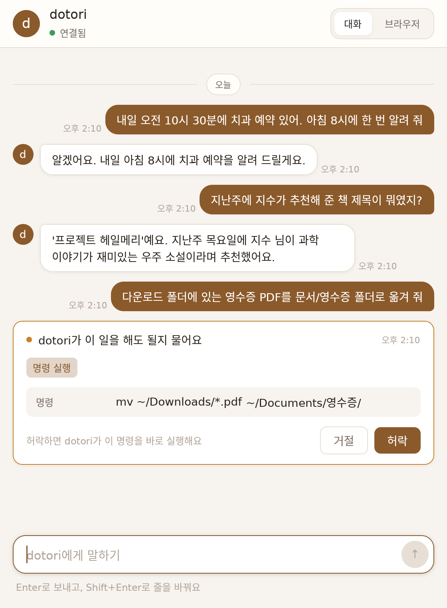
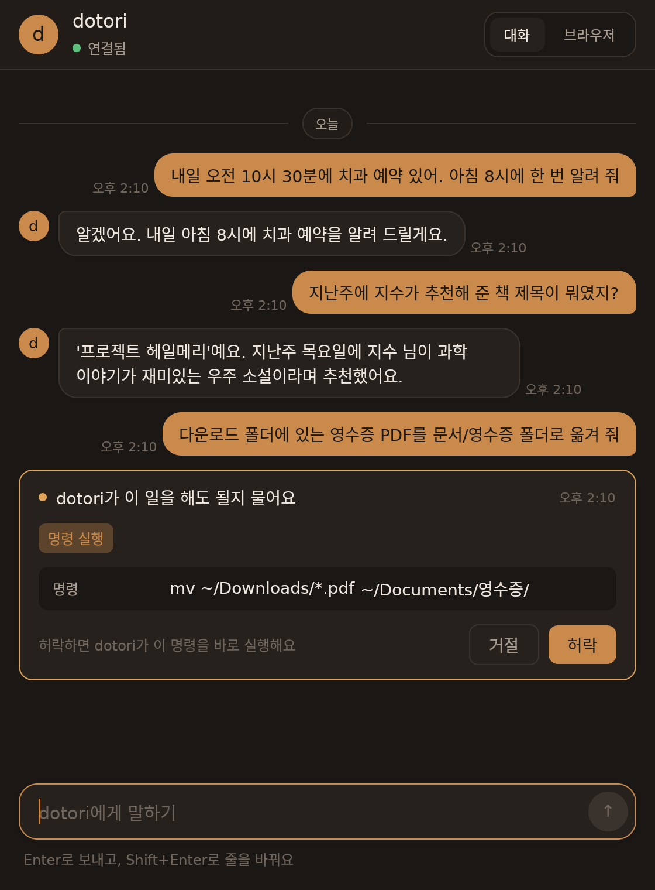

# dotori

[](https://github.com/mathbook3948/dotori/actions/workflows/check.yml)
[](#라이선스)
[](https://doc.rust-lang.org/edition-guide/rust-2024/index.html)

[English](README.md) | 한국어

Rust로 만든, 한 사람을 위한 가벼운 개인 비서.

dotori는 PC 트레이에 상주하면서 주인과 대화 하나를 이어 갑니다. 채팅창, Slack, Telegram, Discord 어디서 말해도 같은 대화로 이어집니다. 주인이 한 말과 비서가 한 일을 원본 기록으로 남기고, 물으면 그 기록에서 찾아 답합니다. 다른 사람에게 하는 행동, 셸 실행, 파일 쓰기는 먼저 주인에게 묻습니다.

<p align="center">
  
  
</p>

## 상태

dotori는 초기 개발 단계입니다. 아직 릴리스가 없고, dotori가 남기는 파일의 형식이 바뀔 수 있습니다. 창은 한국어로만 나옵니다. 지금 기억 검색은 원본 기록에서 찾고, 메모리용 그래프 DB는 아직 개발 중입니다.

## 기능

* 트레이에 상주합니다. 채팅창과 설정창은 [GPUI](https://github.com/zed-industries/zed/tree/main/crates/gpui) 창이고 각자 따로 프로세스로 돌아서, 닫은 창은 메모리를 차지하지 않습니다.
* 주인 한 사람의 비서입니다. 채팅창, Slack, Telegram, Discord가 모두 대화 하나로 이어집니다. 다른 사람이 쓴 글은 참고 자료일 뿐 지시로 받지 않습니다.
* 기억합니다. 모든 대화를 원본 기록으로 남기고, 키워드로 찾고, 임베딩 API를 설정하면 뜻으로도 찾습니다. 기억해 달라는 것은 메모로 두고, 지워 달라는 기록은 지웁니다.
* 전용 브라우저를 씁니다. 자기 Chrome for Testing을 받아 자기 프로필에 로그인을 유지하고, Rust로 만든 JavaScript 인터프리터에서 Playwright 형태의 스크립트를 돌립니다. 채팅창에서 브라우저를 보고 넘겨받을 수 있습니다.
* 큰 일은 서브 세션에 맡깁니다. 서브 세션은 LLM API, Claude Code CLI, Codex CLI로 돌고, 결과는 대화로 돌아옵니다.
* 정해 둔 시간에 루틴을 실행합니다. 고른 요일마다, 또는 한 번만 실행합니다.
* 추가한 외부 MCP 서버를 중계하고, 그 도구 중 무엇을 주인에게 확인받을지 고를 수 있습니다.
* 여러 PC를 비서 하나로 묶습니다. 한 번에 한 PC가 답하고, 원본 기록은 모든 PC에 복제되며, PC 사이 연결은 암호화합니다.
* 다른 사람에게 하는 행동, 셸 실행, 파일 쓰기는 먼저 주인에게 묻습니다.
* Anthropic API나 OpenAI 호환 API를 씁니다.

## 설치와 빠른 시작

Rust 1.100 이상으로 소스에서 빌드합니다. Linux에서는 먼저 GPUI가 빌드에 쓰는 라이브러리를 설치합니다. GPUI는 실행할 때 Vulkan 드라이버도 필요합니다.

```bash
sudo apt-get install -y libxkbcommon-dev libxkbcommon-x11-dev
```

```bash
cargo install --locked --git https://github.com/mathbook3948/dotori dotori
```

태그를 단 버전마다 [Releases](https://github.com/mathbook3948/dotori/releases) 페이지에 Linux, macOS, Windows용 빌드도 올라갑니다. 서명하지 않은 빌드라서 macOS와 Windows는 처음 열 때 경고를 띄웁니다.

dotori를 시작하려면:

1. Anthropic API 키를 환경 변수에 넣습니다.

	```bash
	export ANTHROPIC_API_KEY=sk-ant-...
	```

2. dotori를 실행합니다. 트레이에 아이콘이 생깁니다.

	```bash
	dotori
	```

3. 트레이 메뉴의 **대화창 열기**를 누르거나 `dotori window`를 실행합니다.
4. 모델을 바꾸거나 Slack, Telegram, Discord를 연결하려면 트레이 메뉴의 **설정**을 누르거나 `dotori settings`를 실행합니다.

dotori는 설정과 기록을 폴더 하나에 둡니다. 다른 폴더를 쓰려면 `DOTORI_HOME`을 설정합니다.

| OS | 폴더 |
| --- | --- |
| Linux | `~/.local/share/dotori` |
| macOS | `~/Library/Application Support/dotori` |
| Windows | `%APPDATA%\dotori` |

## 개발

dotori는 [mise](https://mise.jdx.dev)로 Rust 도구 모음과 검사 도구의 버전을 고정합니다. CI가 돌리는 검사를 모두 돌리려면:

```bash
mise install
mise run check
```

설계 결정은 [`docs/`](docs/README.md)에 있습니다. 기여하려면 [CONTRIBUTING](.github/CONTRIBUTING.md)을 읽어 주세요. 보안 문제는 [보안 정책](.github/SECURITY.md)에 따라 알려 주세요.

## 라이선스

Licensed under either of

 * Apache License, Version 2.0
   ([LICENSE-APACHE](LICENSE-APACHE) or http://www.apache.org/licenses/LICENSE-2.0)
 * MIT license
   ([LICENSE-MIT](LICENSE-MIT) or http://opensource.org/licenses/MIT)

at your option.

### 기여

Unless you explicitly state otherwise, any contribution intentionally
submitted for inclusion in the work by you, as defined in the Apache-2.0
license, shall be dual licensed as above, without any additional terms or
conditions.
