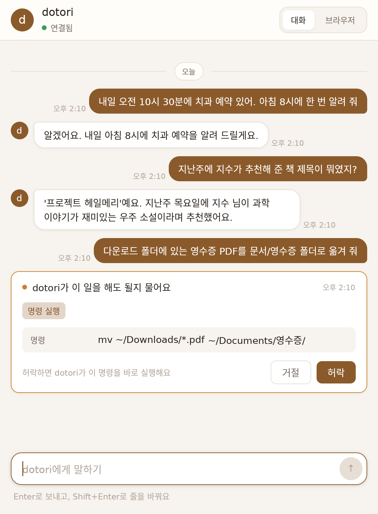
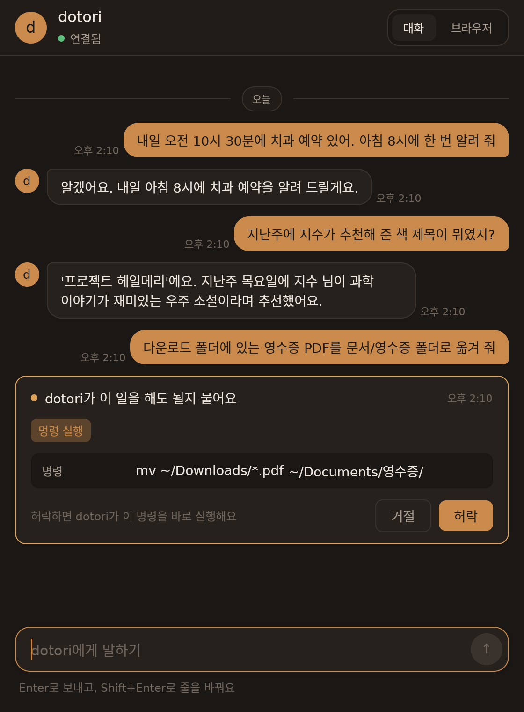

# <picture><source media="(prefers-color-scheme: dark)" srcset=".github/assets/logo-dark.svg"></picture> dotori

[](https://github.com/mathbook3948/dotori/actions/workflows/check.yml)
[](#license)
[](https://doc.rust-lang.org/edition-guide/rust-2024/index.html)

English | [한국어](README.ko.md)

A light personal assistant for one person, written in Rust.

dotori lives in the tray of your PC and keeps one conversation with you. You talk to it in its chat window, Slack, Telegram, or Discord, and every message continues the same conversation. It keeps a raw record of what you said and what it did, searches that record when you ask, and asks you first before it acts toward other people, runs a shell command, or writes a file.

<p align="center">
  
  
</p>

## Status

dotori is in early development. There is no release yet, and the formats of the files it keeps can still change. The windows are in Korean only. Memory search works on the raw record now, and the graph database for memory is still in development.

## Features

* Stays in the tray. The chat window and the settings window are [GPUI](https://github.com/zed-industries/zed/tree/main/crates/gpui) windows that each run in their own process, so a closed window holds no memory.
* Works for one owner. The chat window, Slack, Telegram, and Discord all continue one conversation. What other people write is only reference for dotori, never an instruction.
* Remembers. dotori keeps the raw record of every conversation, searches it by keyword and, with an embedding API, by meaning, keeps notes you ask it to keep, and forgets records when you ask.
* Drives its own browser. dotori downloads its own Chrome for Testing, keeps your logins in its own profile, and runs Playwright-style scripts in a JavaScript interpreter written in Rust. You can watch the browser and take it over from the chat window.
* Hands off large jobs. A sub-session runs on the LLM API, Claude Code CLI, or Codex CLI, and its result comes back into the conversation.
* Runs routines at a time you set, on the days you choose or once.
* Relays MCP servers that you add, and lets you choose which of their tools need your confirmation.
* Joins several PCs into one assistant. One PC answers at a time, the raw record is copied to every PC, and the link between PCs is encrypted.
* Asks you first before it acts toward other people, runs a shell command, or writes a file.
* Talks to the Anthropic API or to any OpenAI-compatible API.

## Install and quick start

Build dotori from source with Rust 1.100 or later. On Linux, install the libraries that GPUI builds against first. GPUI also needs a Vulkan driver when it runs.

```bash
sudo apt-get install -y libxkbcommon-dev libxkbcommon-x11-dev
```

```bash
cargo install --locked --git https://github.com/mathbook3948/dotori dotori
```

Each tagged version also has builds for Linux, macOS, and Windows on the [Releases](https://github.com/mathbook3948/dotori/releases) page. The builds are not signed, so macOS and Windows warn you the first time you open one.

To start dotori:

1. Put your Anthropic API key in the environment.

	```bash
	export ANTHROPIC_API_KEY=sk-ant-...
	```

2. Start dotori. It puts an icon in the tray.

	```bash
	dotori
	```

3. Open the chat window from the tray menu, or run `dotori window`.
4. To change the model or connect Slack, Telegram, or Discord, open the settings window from the tray menu, or run `dotori settings`.

dotori keeps its settings and records in one folder. Set `DOTORI_HOME` to use another folder.

| OS | Folder |
| --- | --- |
| Linux | `$XDG_DATA_HOME/dotori`, or `~/.local/share/dotori` without it |
| macOS | `~/Library/Application Support/dotori` |
| Windows | `%APPDATA%\dotori` |

## Development

dotori uses [mise](https://mise.jdx.dev) to pin the Rust toolchain and the check tools. To run every check that CI runs:

```bash
mise install
mise run check
```

The design decisions are in [`docs/`](docs/README.md), in Korean. To contribute, read [CONTRIBUTING](.github/CONTRIBUTING.md). To report a security problem, follow the [security policy](.github/SECURITY.md).

## License

Licensed under either of

 * Apache License, Version 2.0
   ([LICENSE-APACHE](LICENSE-APACHE) or http://www.apache.org/licenses/LICENSE-2.0)
 * MIT license
   ([LICENSE-MIT](LICENSE-MIT) or http://opensource.org/licenses/MIT)

at your option.

### Contribution

Unless you explicitly state otherwise, any contribution intentionally
submitted for inclusion in the work by you, as defined in the Apache-2.0
license, shall be dual licensed as above, without any additional terms or
conditions.
